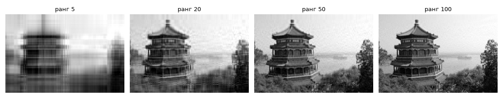

# Урок 7. Сингулярное разложение (SVD)

**Модуль 1 · Линейная алгебра** · ≈ 4,5 ч · пререквизиты: урок 6
**Узел roadmap:** Singular Value Decomposition
**Задания:** [Задания.md](Задания.md) · **Код:** [код/](код/) · **Решения:** [решения/](решения/)

> Вторая из тем, которые ты просил разобрать особенно глубоко. Если запомнить из линейной алгебры одну вещь, пусть это будет SVD: оно объединяет всё, что было в уроках 3–6.

---

## 1. Зачем это нужно

SVD — швейцарский нож прикладной линейной алгебры. В этом курсе оно встретится:
- **PCA** (урок 48) — это буквально SVD центрированной матрицы данных;
- **сжатие и малоранговые приближения**: сжатие изображений, ускорение полносвязных слоёв, LoRA (дообучение больших моделей добавками низкого ранга $W + BA$);
- **рекомендательные системы** (урок 78): матричная факторизация «пользователи × товары»;
- **LSA** в NLP (урок 90): SVD матрицы «документы × слова»;
- **псевдообратная матрица и МНК** (урок 5, 36) — устойчиво даже при вырожденности;
- **гомография и калибровка камеры** (метод DLT): решение однородной системы $Ah = 0$ — правый сингулярный вектор с наименьшим $\sigma$;
- **диагностика**: число обусловленности $\sigma_1/\sigma_n$, спектральная норма $\sigma_1$ (spectral normalization в GAN, урок 87).

## 2. Интуиция

Собственное разложение (урок 6) есть не у всех матриц и только у квадратных. **SVD есть у любой матрицы**, даже прямоугольной $m \times n$:

$$A = U\Sigma V^\top.$$

Геометрически **любое** линейное отображение — это три шага:
1. $V^\top$ — **поворот** (или отражение) в исходном пространстве $\mathbb{R}^n$;
2. $\Sigma$ — **растяжение вдоль осей**: ось $i$ растягивается в $\sigma_i \ge 0$ раз, лишние оси выбрасываются или добавляются нулями;
3. $U$ — **поворот** в пространстве-образе $\mathbb{R}^m$.

Единичная сфера переходит в эллипсоид: его полуоси — $\sigma_i$, а их направления — столбцы $U$. Столбцы $V$ — те направления на исходной сфере, которые перешли в полуоси.

**Вторая картинка — сумма слоёв.** $A = \sum_i \sigma_i u_i v_i^\top$ — сумма матриц ранга 1, упорядоченных по «важности» $\sigma_1 \ge \sigma_2 \ge \dots$. У фотографии первые слагаемые несут общую структуру (крупные пятна света и тени), последние — мелкие детали и шум. Если оставить первые $k$ слагаемых, получится лучшее возможное приближение ранга $k$. Это теорема Эккарта–Юнга.

## 3. Математика

### 3.1. Построение SVD через $A^\top A$

Пусть $A \in \mathbb{R}^{m \times n}$, ранг $r$.

**Шаг 1.** $A^\top A$ — симметричная PSD-матрица $n \times n$ (урок 6, 3.4). По спектральной теореме $A^\top A = V\Lambda V^\top$, где $V$ ортогональна, $\lambda_1 \ge \dots \ge \lambda_n \ge 0$.

**Шаг 2.** Определим **сингулярные числа** $\sigma_i = \sqrt{\lambda_i}$. Ровно $r$ из них положительны.

**Шаг 3.** Для $i \le r$ положим $u_i = \dfrac{A v_i}{\sigma_i}$. Проверим, что $u_i$ ортонормированы:

$$u_i^\top u_j = \frac{v_i^\top A^\top A v_j}{\sigma_i \sigma_j} = \frac{\lambda_j\, v_i^\top v_j}{\sigma_i\sigma_j} = \begin{cases}\lambda_i/\sigma_i^2 = 1, & i = j,\\ 0, & i \neq j.\end{cases}$$

**Шаг 4.** По построению $A v_i = \sigma_i u_i$ при $i \le r$ и $A v_i = 0$ при $i > r$ (так как $\|Av_i\|^2 = \lambda_i = 0$). В матричной форме $AV = U\Sigma$, а раз $V$ ортогональна, то $A = U\Sigma V^\top$. $\blacksquare$

Попутно доказали:
- $\operatorname{rank} A$ = число ненулевых $\sigma_i$;
- столбцы $V$ — собственные векторы $A^\top A$, столбцы $U$ — собственные векторы $AA^\top$ (проверь: $AA^\top u_i = \sigma_i^2 u_i$);
- **тонкое (thin) SVD** — только $r$ (или $\min(m,n)$) столбцов $U$ и $V$. Оно и нужно на практике (`full_matrices=False`).

Для симметричной PSD-матрицы SVD совпадает с собственным разложением. Для симметричной с отрицательными $\lambda$ — почти: $\sigma_i = |\lambda_i|$, знак уходит в $U$.

### 3.2. Нормы, обусловленность и ранг через $\sigma$

- **Спектральная норма:** $\|A\|_2 = \max_{\|x\|=1}\|Ax\| = \sigma_1$. Поворот не меняет длину, а растяжение максимально вдоль первой оси.
- **Фробениусова:** $\|A\|_F^2 = \operatorname{tr}(A^\top A) = \sum_i \lambda_i = \sum_i \sigma_i^2$.
- **Число обусловленности:** $\kappa(A) = \sigma_1/\sigma_r$. Отсюда $\kappa(A^\top A) = \sigma_1^2/\sigma_r^2 = \kappa(A)^2$ — обещанное в уроке 5 «квадрирование».
- **Численный ранг** = число $\sigma_i$, бо́льших порога $\varepsilon\,\sigma_1$. Это единственный надёжный способ определить ранг на реальных данных.

### 3.3. Псевдообратная и МНК

$$A^+ = V\Sigma^+ U^\top, \qquad \Sigma^+ = \operatorname{diag}(1/\sigma_1, \dots, 1/\sigma_r, 0, \dots, 0).$$

Вектор $x^+ = A^+ b$ — решение задачи МНК $\min\|Ax - b\|$, и среди всех решений у него **минимальная норма**. Обоснование: в координатах $\tilde x = V^\top x$, $\tilde b = U^\top b$ задача распадается на независимые $\sigma_i \tilde x_i \approx \tilde b_i$. При $\sigma_i > 0$ решение однозначно: $\tilde x_i = \tilde b_i/\sigma_i$. При $\sigma_i = 0$ координата $\tilde x_i$ на ошибку не влияет, и чтобы норма была минимальной, берём $\tilde x_i = 0$.

**Почему маленькие $\sigma$ опасны.** Деление на $\sigma_i \approx 10^{-10}$ умножает шум в $\tilde b_i$ в $10^{10}$ раз. Есть два лекарства:
- *обрезать* — считать такие $\sigma_i$ нулём (параметр `rcond` в `np.linalg.pinv`);
- *смягчить* — Ridge: $\tilde x_i = \dfrac{\sigma_i}{\sigma_i^2 + \lambda}\tilde b_i$, то есть плавный фильтр вместо деления. Это объясняет Ridge в уроке 40 через SVD.

### 3.4. Теорема Эккарта–Юнга (Eckart–Young)

Пусть $A_k = \sum_{i=1}^{k} \sigma_i u_i v_i^\top$. Тогда для **любой** матрицы $B$ ранга $\le k$:

$$\|A - B\|_2 \ge \|A - A_k\|_2 = \sigma_{k+1}, \qquad \|A - B\|_F \ge \|A - A_k\|_F = \sqrt{\textstyle\sum_{i>k}\sigma_i^2}.$$

**Доказательство для спектральной нормы.**
1. Ошибка $A_k$: $A - A_k = \sum_{i>k}\sigma_i u_i v_i^\top$ — это SVD самой разности, её наибольшее сингулярное число $\sigma_{k+1}$.
2. Пусть $\operatorname{rank} B \le k$. По теореме о ранге и дефекте (урок 5) ядро $B$ имеет размерность $\ge n - k$. Подпространство $\operatorname{span}(v_1, \dots, v_{k+1})$ имеет размерность $k+1$. Сумма размерностей $> n$, значит они пересекаются: найдётся единичный $w = \sum_{i=1}^{k+1} c_i v_i$ с $Bw = 0$.
3. Тогда $\|(A - B)w\| = \|Aw\| = \big\|\sum_{i \le k+1} c_i \sigma_i u_i\big\| = \sqrt{\sum_{i\le k+1} c_i^2\sigma_i^2} \ge \sigma_{k+1}\sqrt{\sum c_i^2} = \sigma_{k+1}$.
4. Значит, $\|A - B\|_2 \ge \sigma_{k+1}$. $\blacksquare$

**Смысл:** усечённое SVD — оптимальное сжатие. Никакой другой способ представить матрицу через $k$ «слоёв» не даёт меньшей ошибки. Доля «энергии» $\sum_{i\le k}\sigma_i^2 / \sum_i\sigma_i^2$ показывает, сколько информации сохранилось.

### 3.5. PCA — это SVD

Пусть $X \in \mathbb{R}^{N \times d}$ — данные, $X_c$ — центрированные ($\bar x = 0$), $X_c = U\Sigma V^\top$. Тогда ковариация

$$C = \frac{1}{N-1}X_c^\top X_c = \frac{1}{N-1}V\Sigma U^\top U \Sigma V^\top = V\,\frac{\Sigma^2}{N-1}\,V^\top.$$

Это собственное разложение $C$. Отсюда:
- главные направления — столбцы $V$ (строки `Vt`);
- дисперсии вдоль них — $\sigma_i^2/(N-1)$;
- координаты объектов в новом базисе — $X_c V = U\Sigma$.

`sklearn.decomposition.PCA` так и считает — через SVD, а не через собственное разложение ковариации. Явное построение $X^\top X$ квадрирует обусловленность (3.2) и теряет точность.

### 3.6. Однородные системы и DLT

Задача $\min_{\|h\| = 1}\|Ah\|$ (найти «почти-ядро» матрицы) решается последним правым сингулярным вектором $v_n$, а ошибка равна $\sigma_n$. Доказательство то же, что у отношения Рэлея (урок 6, 3.5), только для минимума и для $A^\top A$. Так восстанавливают гомографию по $N \ge 4$ парам точек (метод DLT, Direct Linear Transform), фундаментальную матрицу и параметры камеры.

## 4. Реализация с нуля на NumPy

Файл: [код/svd.py](код/svd.py).

```python
def svd_via_eigh(A, tol=1e-6):
    lam, V = np.linalg.eigh(A.T @ A)
    order = np.argsort(lam)[::-1]                       # по убыванию, как принято для SVD
    lam, V = np.clip(lam[order], 0, None), V[:, order]
    s = np.sqrt(lam)
    r = int(np.sum(s > tol * s[0]))                     # численный ранг
    U = A @ V[:, :r] / s[:r]                            # делим каждый столбец на своё σ (broadcasting по строке)
    return U, s[:r], V[:, :r].T


def low_rank(A, k):
    U, s, Vt = np.linalg.svd(A, full_matrices=False)
    return (U[:, :k] * s[:k]) @ Vt[:k]


def pinv_svd(A, rcond=1e-12):
    U, s, Vt = np.linalg.svd(A, full_matrices=False)
    s_inv = np.where(s > rcond * s.max(), 1 / s, 0.0)
    return (Vt.T * s_inv) @ U.T
```

Обрати внимание на `U * s` вместо `U @ np.diag(s)`. Умножение на диагональную матрицу справа — это масштабирование столбцов, и broadcasting делает его за $O(mn)$ без создания матрицы $k \times k$.

Допуск `tol=1e-6` в учебной версии грубый не случайно. Через $A^\top A$ мы квадрируем обусловленность, и сингулярные числа меньше ≈ $10^{-8}\sigma_1$ этим способом не вычислить. Первая версия теста с допуском $10^{-12}$ упала: шум округления в $\lambda \approx 10^{-15}$ превратился в «сингулярное число» $3 \cdot 10^{-8}$. Вот почему `np.linalg.svd` работает с самой $A$ (через бидиагонализацию), а не с $A^\top A$.

Вывод `python svd.py`:

```
свой SVD: A = U Σ V^T: True | U^T U = I: True
σ свои : [3.036073 2.03354  1.856326 0.895371]
σ numpy: [3.036073 2.03354  1.856326 0.895371]
||A||_2 = σ1: True | ||A||_F^2 = Σσ²: True
κ(A) = 3.391 | κ(A^T A) = 11.498 = κ(A)^2 = 11.498
k= 1: ||B-B_k||_F = 36.2512 (теория 36.2512), ||B-B_k||_2 = 11.6843 (σ_2 = 11.6843)
k= 5: ||B-B_k||_F = 29.3918 (теория 29.3918), ||B-B_k||_2 = 9.0177 (σ_6 = 9.0177)
k=20: ||B-B_k||_F = 10.6550 (теория 10.6550), ||B-B_k||_2 = 4.4827 (σ_21 = 4.4827)
pinv через SVD == np.linalg.pinv: True
DLT по 10 точкам восстановил H: True
```

Каждая строка проверяет одно утверждение раздела 3: нормы через $\sigma$, $\kappa(A^\top A) = \kappa(A)^2$, обе формы Эккарта–Юнга, $A^+$ и DLT. Тест `test_eckart_young_beats_random_rank_k` дополнительно проверяет, что 50 случайных матриц ранга 3 никогда не бьют усечённое SVD.

## 5. Библиотеки: сжатие картинки, PCA, усечённое SVD

Файл: [код/image_and_pca.py](код/image_and_pca.py).

**Сжатие изображения** 427×640 (оттенки серого):

```
k=  5: энергия 0.9661, PSNR 18.38 дБ, хранится 2.0% чисел
k= 20: энергия 0.9814, PSNR 20.99 дБ, хранится 7.8% чисел
k= 50: энергия 0.9894, PSNR 23.44 дБ, хранится 19.5% чисел
k=100: энергия 0.9946, PSNR 26.35 дБ, хранится 39.1% чисел
```



Хранить нужно $k(m + n + 1)$ чисел вместо $mn$. При ранге 5 сохранено 96,6% энергии, но картинка размыта: «энергия» — это в основном средняя яркость и крупные пятна, а глаз чувствителен к краям. Поэтому JPEG использует не SVD, а локальное DCT-преобразование: на фотографиях оно эффективнее.

**PCA через SVD против `sklearn`** (датасет digits, 1797 × 64):

```
PCA: направления совпадают (с учётом знака): True
PCA: дисперсии совпадают: True
PCA: проекции совпадают: True
доля объяснённой дисперсии 10 компонент: 0.738
```

Совпадение — **с учётом знака**. Пара $(u_i, v_i)$ и пара $(-u_i, -v_i)$ дают одно и то же слагаемое, поэтому знак у SVD произволен. sklearn фиксирует его функцией `svd_flip`. Никогда не сравнивай сингулярные векторы из разных библиотек напрямую.

**Полное SVD против рандомизированного усечённого:**

```
полное SVD 3000x2000: 1.39 с | TruncatedSVD(k=20): 0.08 с
первые 5 σ, полное:    [2913.85 2884.86 2871.29 2850.44 2802.35]
первые 5 σ, TruncSVD:  [2912.13 2874.55 2867.15 2844.57 2794.88]
```

`TruncatedSVD` в 17 раз быстрее, но приближённый: ошибка до 0,4%. Матрица здесь — 50 сопоставимых по силе компонент плюс шум. Мы просим 20 из них, а между 20-м и 21-м сингулярным числом почти нет зазора. Рандомизированным методам (Halko et al., 2011) нужен заметный «спад» спектра после $k$-го числа. Точность растёт с параметром `n_iter`. Это разбирается в задании 🔴.

## 6. Типичные ошибки и как их отлаживать

| Ошибка | Последствие | Как правильно |
|---|---|---|
| Сравнение сингулярных векторов напрямую | «Тест падает», хотя всё верно: знаки разные | Сравнивать с точностью до знака или сравнивать $A_k$ |
| `full_matrices=True` (по умолчанию в NumPy) для высокой матрицы | `U` размера $m \times m$: для $10^5 \times 100$ это 80 ГБ | `full_matrices=False` |
| PCA без центрирования | Первая «компонента» указывает на среднее, а не на направление разброса | Вычесть среднее (`TruncatedSVD` его **не** вычитает — так задумано для разреженных данных) |
| `Vt` перепутан с `V` | Главные направления — **строки** `Vt`, а не столбцы | `Vt[:k]` — первые $k$ направлений |
| SVD через `eigh(A.T @ A)` в продакшене | Потеря половины значащих цифр | `np.linalg.svd` / `scipy.linalg.svd` |
| `pinv` без порога на маленьких $\sigma$ | Взрыв шума | Параметр `rcond`, или Ridge |

## 7. Упражнения

Вынесены в отдельный файл: **[Задания.md](Задания.md)**.

## 8. Вопросы для самопроверки

1. Объясни геометрический смысл $A = U\Sigma V^\top$. Чем SVD отличается от собственного разложения и почему существует для любой матрицы?
2. Как связаны сингулярные числа $A$ с собственными значениями $A^\top A$? Выведи $u_i = Av_i/\sigma_i$ и докажи ортонормированность $u_i$.
3. Выразите $\|A\|_2$, $\|A\|_F$, $\kappa(A)$ и ранг через сингулярные числа.
4. Сформулируй теорему Эккарта–Юнга и докажи её для спектральной нормы.
5. Почему PCA считают через SVD центрированных данных, а не через `eigh` ковариации?
6. Как найти решение $\min_{\|h\|=1}\|Ah\|$ и где это применяется в CV?
7. Сколько чисел нужно хранить для приближения ранга $k$ матрицы $m \times n$? При каком $k$ сжатие перестаёт иметь смысл?

## 9. Ресурсы

### Узел «Singular Value Decomposition»

| | Ресурс | Язык · цена · уровень | Зачем открыть |
|---|---|---|---|
| ⭐ 📘 | Deisenroth et al., [MML](https://mml-book.github.io/), **гл. 4.5 «Singular Value Decomposition», 4.6 «Matrix Approximation», гл. 10 «PCA»** | EN · бесплатно · базовый→продвинутый | Построение SVD, Эккарт–Юнг и PCA как применение — ровно маршрут этого урока |
| 🎥 | MIT 18.065 (Strang), [Matrix Methods in Data Analysis, Signal Processing, and Machine Learning](https://ocw.mit.edu/courses/18-065-matrix-methods-in-data-analysis-signal-processing-and-machine-learning-spring-2018/) — **лекции 6–7 (SVD, Eckart–Young), 8 (нормы)** | EN · бесплатно · продвинутый | SVD от автора лучших учебников линейной алгебры, с прицелом на ML |
| 📘 | Gilbert Strang, *Linear Algebra and Learning from Data* (2019), **гл. I.8–I.9** — [страница книги](https://math.mit.edu/~gs/learningfromdata/), проверить ссылку | EN · платно · продвинутый | Учебник к 18.065: SVD, PCA и малоранговые приближения |
| 📄 | Blum, Hopcroft, Kannan, [Foundations of Data Science, гл. 3 «Best-Fit Subspaces and SVD»](https://www.cs.cmu.edu/~venkatg/teaching/CStheory-infoage/book-chapter-4.pdf) [roadmap.sh] | EN · бесплатно · продвинутый | SVD через «лучшие подпространства» — другой взгляд на ту же теорему |
| 📑 | Halko, Martinsson, Tropp, *Finding Structure with Randomness: Probabilistic Algorithms for Constructing Approximate Matrix Decompositions* (SIAM Review, 2011) — найти по названию (есть на arXiv) | EN · бесплатно · продвинутый | Оригинал рандомизированного SVD для задания 🔴 и `TruncatedSVD` |
| 🎥 | [SVD: Overview](https://www.youtube.com/watch?v=gXbThCXjZFM) (Steve Brunton) [roadmap.sh] | EN · бесплатно · базовый | Серия коротких видео про SVD с примерами на картинках |

---

## Ответы на вопросы для самопроверки

1. Любое линейное отображение = поворот ($V^\top$) → растяжение вдоль осей ($\Sigma$) → поворот ($U$); единичная сфера переходит в эллипсоид с полуосями $\sigma_i$. Собственное разложение использует **один** базис для входа и выхода и есть только у (некоторых) квадратных матриц. SVD использует **два** разных ортонормированных базиса и существует всегда, потому что строится из спектрального разложения симметричной PSD-матрицы $A^\top A$, которое существует всегда.
2. $\sigma_i^2 = \lambda_i(A^\top A)$. Из $A^\top A v_i = \sigma_i^2 v_i$: $u_i := Av_i/\sigma_i$, и $u_i^\top u_j = v_i^\top A^\top A v_j/(\sigma_i\sigma_j) = \sigma_j^2 v_i^\top v_j/(\sigma_i\sigma_j) = \delta_{ij}$.
3. $\|A\|_2 = \sigma_1$; $\|A\|_F = \sqrt{\sum\sigma_i^2}$; $\kappa = \sigma_1/\sigma_r$; ранг = число ненулевых (больше порога) $\sigma_i$.
4. См. 3.4: $A_k$ даёт ошибку $\sigma_{k+1}$. Для любой $B$ ранга $\le k$ её ядро пересекается с $\operatorname{span}(v_1..v_{k+1})$; на единичном векторе $w$ из пересечения $\|(A-B)w\| = \|Aw\| \ge \sigma_{k+1}$.
5. Ковариация $\propto X_c^\top X_c$, а её явное построение квадрирует обусловленность: маленькие дисперсии считаются с огромной относительной ошибкой. SVD работает с $X_c$ напрямую. Плюс SVD сразу даёт координаты объектов $U\Sigma$.
6. Последний правый сингулярный вектор $v_n$ (минимальное $\sigma$), ошибка $\sigma_n$. В CV — метод DLT: гомография по $N \ge 4$ точкам, фундаментальная и существенная матрицы, калибровка камеры, триангуляция.
7. $k(m + n + 1)$ (столбцы $U$, строки $V^\top$, сами $\sigma$). Выгодно, пока $k(m+n+1) < mn$, то есть $k < mn/(m+n+1)$. Для 427×640 это $k < 256$. На практике выгоду съедает качество.

---

**Следующий урок — урок 8: производные и частные производные.** Он начинается с диагностического теста. Команда: «Дальше».
