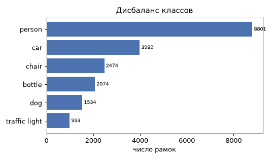
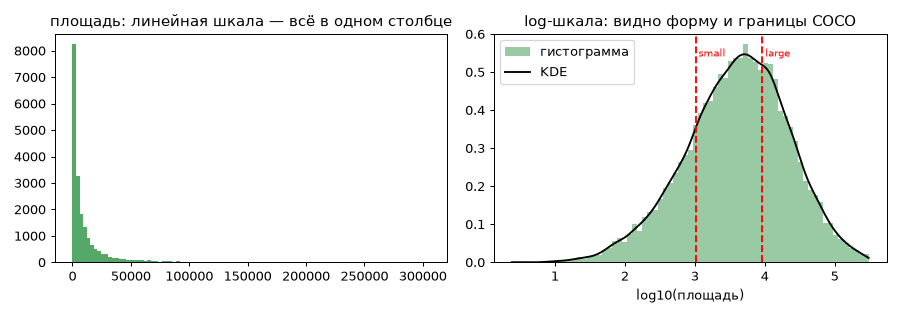
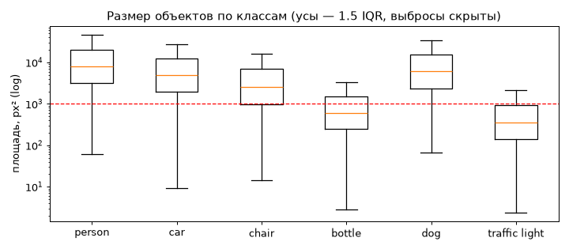
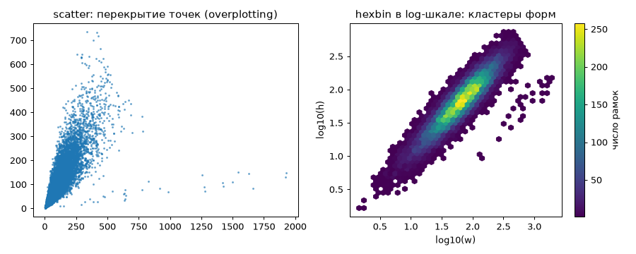
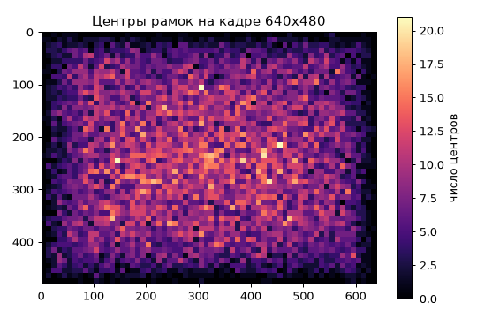
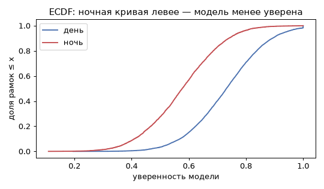

# Урок 17. Графики и диаграммы

**Модуль 1 · Статистика** · ≈ 1,5 ч · пререквизиты: урок 16
**Узел roadmap:** Graphs & Charts
**Задания:** [Задания.md](Задания.md) · **Код:** [код/](код/) · **Решения:** [решения/](решения/)

> Здесь главное — **какой график для какого вопроса** и как не обмануть себя графиком. Технику Matplotlib и Seaborn разберём подробно в уроках 23–24.

---

## 1. Зачем это нужно

Числа из урока 16 отвечают на вопросы, которые ты догадался задать. График показывает то, о чём ты не догадался спросить. Классический пример — квартет Энскомба: четыре набора данных с одинаковыми средними, дисперсиями и корреляцией, но совершенно разной структурой. Здесь то же самое: в данных урока 16 после удаления «невозможных» рамок остался скрытый кластер ошибок разметки. Таблица его не показала, а hexbin на рисунке 4 показывает сразу.

В работе ML-инженера графики нужны для:
- EDA датасета (дисбаланс, размеры, расположение объектов);
- контроля обучения (кривые потерь и метрик, урок 67);
- анализа ошибок модели (срезы, матрица ошибок — урок 58, ROC/PR — урок 58);
- объяснения результатов людям.

## 2. Интуиция: вопрос → график

| Вопрос | График | Чего избегать |
|---|---|---|
| Сколько в каждой категории? | Горизонтальные столбцы, отсортированные | Круговая диаграмма (глаз плохо сравнивает углы) |
| Как распределена одна величина? | Гистограмма, KDE, ECDF; для скошенных — в log-шкале | Слишком мало или слишком много столбцов |
| Как распределения отличаются по группам? | Boxplot, violin, наложенные ECDF | Наложенные гистограммы разного размера групп |
| Как связаны две величины? | Scatter; при тысячах точек — hexbin или 2D-гистограмма | Scatter без прозрачности (overplotting) |
| Где на картинке? | Тепловая карта (`imshow` 2D-гистограммы) | Радужная палитра `jet` |
| Как менялось во времени / по эпохам? | Линия | Две оси Y с разным масштабом |

**Принципы честного графика:**
- ось столбцов начинается с нуля;
- шкала (линейная или логарифмическая) подписана;
- палитра перцептивно равномерная (`viridis`, `magma`), а не `jet`;
- у каждого графика заголовок формулирует вопрос или вывод.

## 3. Математика: гистограмма и KDE — оценки плотности

### 3.1. Гистограмма

Делим ось на столбцы ширины $h$. Высота столбца — оценка плотности:

$$\hat f(x) = \frac{\#\{x_i \in \text{столбец}(x)\}}{n\,h}.$$

Деление на $nh$ делает площадь под гистограммой равной 1, и её можно сравнивать с плотностью распределения (параметр `density=True`).

**Компромисс ширины столбца** — первая встреча со «смещением и разбросом» (урок 37). Широкие столбцы сглаживают детали (большое смещение). Узкие столбцы шумят: в каждом мало точек, большой разброс. Правило **Фридмана–Диакониса** даёт робастный компромисс:

$$h = 2\,\text{IQR}\cdot n^{-1/3}.$$

Ширина пропорциональна разбросу данных (через устойчивый IQR) и убывает как $n^{-1/3}$: при большем числе данных можно позволить себе больше деталей.

### 3.2. Ядерная оценка плотности (KDE)

Вместо столбцов на каждую точку ставим маленький «холмик» — ядро $K$ (обычно нормальную плотность) ширины $h$ — и складываем:

$$\hat f(x) = \frac{1}{nh}\sum_{i=1}^{n}K\Big(\frac{x - x_i}{h}\Big).$$

Каждое ядро интегрируется в 1, поэтому и сумма, делённая на $n$, — плотность. Ширина $h$ (bandwidth) играет ту же роль, что ширина столбца. Правило Скотта для нормального ядра: $h = \hat\sigma\,n^{-1/5}$. Его используют `scipy.stats.gaussian_kde` и seaborn по умолчанию.

**Подвох:** KDE «размазывает» плотность за физические границы. У площади или уверенности модели KDE покажет ненулевую плотность ниже нуля или выше 1. Поэтому для ограниченных величин лучше ECDF или гистограмма.

### 3.3. ECDF

Эмпирическая функция распределения $\hat F(x) = \frac1n\#\{x_i \le x\}$ (урок 14) — **без параметров сглаживания**. По ней сразу читаются медиана ($\hat F = 0{,}5$), квантили и доли. Кривые разных групп легко сравнивать на одном графике. Для сравнения распределений по срезам это часто лучший выбор.

## 4. Реализация с нуля

Файл: [код/density.py](код/density.py):

```python
def fd_bin_width(x):
    q75, q25 = np.percentile(x, [75, 25])
    return 2 * (q75 - q25) / len(x) ** (1 / 3)

def kde(x, grid, bandwidth=None):
    h = bandwidth if bandwidth is not None else x.std(ddof=1) * len(x) ** (-1 / 5)
    u = (grid[:, None] - x[None, :]) / h                  # (len(grid), n) — все пары «точка сетки × наблюдение»
    return np.exp(-0.5 * u**2).sum(axis=1) / (len(x) * h * np.sqrt(2 * np.pi))
```

```
ширина столбца FD: своя 0.2590 | numpy 'fd': 0.2533
площадь под гистограммой: 1.0000
KDE совпадает со scipy.stats.gaussian_kde: True
площадь под KDE: 1.0000
```

Ширина у numpy чуть меньше: она округляет **число** столбцов до целого, чтобы они ровно покрывали диапазон данных, и пересчитывает ширину. Наша KDE совпала со `scipy` точно. Обрати внимание на `grid[:, None] - x[None, :]`: broadcasting строит матрицу всех пар «точка сетки × наблюдение» без циклов. Это тот же приём, что попарные расстояния в уроке 3.

## 5. EDA-графики на Matplotlib

Файл: [код/eda_plots.py](код/eda_plots.py) строит 6 графиков по синтетическим аннотациям из урока 16. Перед этим он отбрасывает невозможные рамки.

**1. Дисбаланс классов** — отсортированные горизонтальные столбцы с подписями:



**2. Распределение площадей** — одна и та же величина в двух шкалах:



В линейной шкале всё сжато в первом столбце, в логарифмической видны форма распределения и границы small/large из COCO.

**3. Размер по классам** — boxplot в log-шкале:



**4. Формы рамок:**



Слева — 20 000 точек scatter: облако сливается, плотность не видна. Справа hexbin в log-шкале показывает основное облако (форма ≈ квадрат) **и отдельный маленький кластер справа внизу** — рамки, у которых ширина умножена на 15. Это внесённые ошибки разметки, которые прошли фильтр «невозможных» значений из урока 16. Ни одна сводная таблица их бы не показала.

**5. Где на кадре объекты** — тепловая карта центров рамок:



В синтетике центры распределены равномерно. На реальных данных (мини-проект 2, COCO) будет виден сдвиг к центру кадра и к нижней половине («фотограф держит объект в центре», «люди стоят на земле»).

**6. Уверенность модели днём и ночью** — ECDF:



Ночная кривая левее: при любом пороге уверенности ночных рамок ниже порога больше.

## 6. Типичные ошибки и как их отлаживать

| Ошибка | Последствие | Как правильно |
|---|---|---|
| Гистограмма скошенной величины в линейной шкале | Вся информация в одном столбце | `np.log10` или `ax.set_xscale("log")` с логарифмическими столбцами |
| Scatter на десятках тысяч точек | Overplotting: плотность не видна, редкие кластеры теряются | `alpha`, hexbin, 2D-гистограмма |
| Сравнение групп наложенными гистограммами | Группы разного размера несравнимы | `density=True`, ECDF или boxplot |
| Обрезанная ось Y у столбцов | Разница 2% выглядит как двукратная | Ось с нуля или явная подпись |
| Палитра `jet` | Ложные границы, плохо читается при дальтонизме | `viridis`, `magma`, `cividis` |
| KDE для ограниченных величин | Плотность «вытекает» за 0 и 1 | Гистограмма или ECDF |
| `plt.show()` в скрипте без GUI | Скрипт «висит» или падает на сервере | `fig.savefig(...)`, `plt.close(fig)`; бэкенд `Agg` |

## 7. Упражнения

Вынесены в отдельный файл: **[Задания.md](Задания.md)**.

## 8. Вопросы для самопроверки

1. Какой график выбрать, чтобы сравнить распределение площадей объектов для 6 классов? А для сравнения двух моделей по уверенности?
2. Как гистограмма связана с плотностью вероятности? Что делает `density=True`?
3. Объясни компромисс ширины столбца гистограммы. Что предлагает правило Фридмана–Диакониса и почему там IQR?
4. Выведи формулу KDE и объясни роль ширины ядра.
5. Что такое overplotting и как с ним бороться?
6. Почему ECDF удобна для сравнения групп?

## 9. Ресурсы

### Узел «Graphs & Charts»

| | Ресурс | Язык · цена · уровень | Зачем открыть |
|---|---|---|---|
| ⭐ 📘 | Claus O. Wilke, *Fundamentals of Data Visualization* (O'Reilly, 2019), бесплатная онлайн-версия — найти по названию (clauswilke.com) | EN · бесплатно онлайн · базовый | Лучшая книга о выборе графика под вопрос; главы о распределениях, долях, палитрах |
| 📘 | Allen Downey, [Think Stats 3e](https://greenteapress.com/wp/think-stats-3e/) — главы о гистограммах, PMF/CDF и KDE | EN · бесплатно · базовый | Гистограмма, CDF и KDE как инструменты анализа, в Python |
| 📄 | Matplotlib, [Plot types](https://matplotlib.org/stable/plot_types/index.html) — проверить ссылку | EN · бесплатно · базовый | Галерея типов графиков с кодом |
| 📄 | IBM, [What is Data Visualization?](https://www.ibm.com/think/topics/data-visualization) [roadmap.sh] | EN · бесплатно · базовый | Обзорная статья, прикреплённая к узлу на roadmap.sh |
| 🎥 | Stepik, [Основы статистики](https://stepik.org/course/76) — уроки о визуализации распределений | RU · бесплатно · базовый | Гистограммы и боксплоты на русском |

---

## Ответы на вопросы для самопроверки

1. Для 6 классов — boxplot или violin в log-шкале (центр, разброс и хвосты видны рядом). Для двух моделей — наложенные ECDF или две гистограммы с `density=True`.
2. Высота столбца, делённая на $nh$, — оценка плотности в этом интервале. `density=True` делает площадь под гистограммой равной 1, и её можно сравнивать с теоретической плотностью и с гистограммами других размеров выборки.
3. Широкие столбцы — гладко, но детали теряются (смещение). Узкие — детально, но шумно (разброс). FD: $h = 2\,\text{IQR}\,n^{-1/3}$. IQR — робастная мера разброса: выбросы не раздувают ширину.
4. $\hat f(x) = \frac{1}{nh}\sum K((x - x_i)/h)$ — сумма «холмиков» на каждой точке. $h$ управляет гладкостью: маленькая даёт «частокол» пиков, большая размывает структуру.
5. Точки рисуются поверх друг друга, и плотная область выглядит так же, как разреженная. Помогают прозрачность, hexbin или 2D-гистограмма, сэмплирование, логарифмические оси.
6. Нет параметров сглаживания, все точки учтены. Медиана, квантили и доли читаются прямо по графику, а кривые разных групп разного размера сравнимы на одной оси.

---

**Следующий урок — урок 18: инференциальная статистика (доверительные интервалы, тесты, бутстрап).** Команда: «Дальше».
