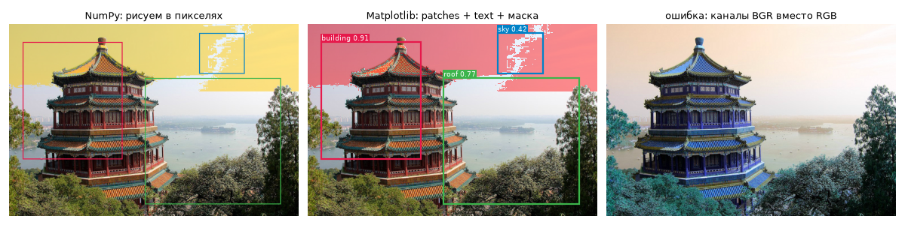
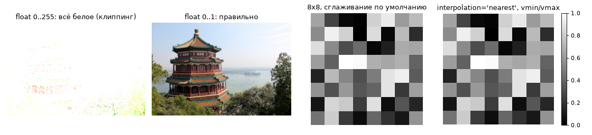
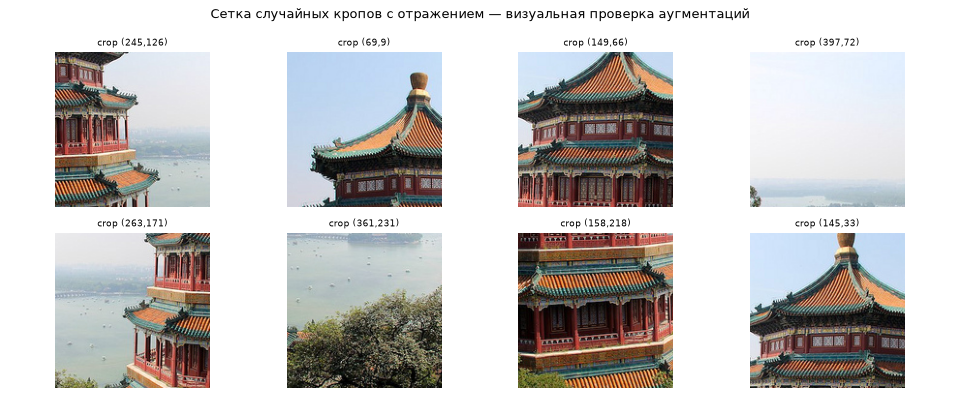

# Урок 23. Matplotlib для CV: рамки, маски, сетки картинок

**Модуль 2 · Основные библиотеки** · ≈ 1,5 ч · пререквизиты: урок 21
**Узел roadmap:** Matplotlib
**Задания:** [Задания.md](Задания.md) · **Код:** [код/](код/) · **Решения:** [решения/](решения/)

---

## 1. Зачем это нужно

Главное правило CV-инженера: **смотри на данные глазами** — на каждом этапе. Рамки после аугментации на месте? Маска не сдвинута на пиксель? Батч не перевёрнут по каналам? Модель ошибается на чём-то общем? Сводные числа такое пропускают, картинка — показывает. Matplotlib — инструмент, которым это делается в ноутбуках и отчётах.

## 2. Интуиция: объектный API

У Matplotlib два интерфейса. «Глобальный» `plt.plot(...)` удобен в одну строку. Для всего остального используй **объектный**:

- `fig` — холст (размер, dpi, сохранение);
- `ax` — одна система координат с осями; на `ax` рисуют: `ax.imshow`, `ax.add_patch`, `ax.text`, `ax.set_title`;
- `fig, axes = plt.subplots(2, 4)` — сетка; `axes.flat` — перебор всех `ax`.

Функция вида `show_detections(ax, img, boxes, ...)` переиспользуется в любой сетке, отчёте и дашборде. Код, рисующий в «текущие» оси через `plt.*`, — нет.

## 3. Как это устроено (вместо математики)

### 3.1. Как `imshow` понимает массив

| Массив | Трактовка |
|---|---|
| `(H, W, 3)` `uint8` | RGB, значения 0–255 |
| `(H, W, 3)` `float` | RGB, значения **0–1**; всё за пределами обрезается (с предупреждением) |
| `(H, W)` | Одноканальный: значения отображаются через `cmap`, диапазон — `vmin`/`vmax` (по умолчанию min и max **этой** картинки) |
| `(H, W, 4)` | RGBA: альфа-канал — прозрачность |

Последствие 2-й строки: картинка, переведённая в float **без деления на 255**, выглядит почти белой. Последствие 3-й: две маски вероятностей с разными диапазонами без явных `vmin=0, vmax=1` нельзя сравнивать по цвету — каждая растянута на свой диапазон.

### 3.2. Система координат

`imshow` по умолчанию кладёт начало в **левый верхний угол**, ось Y направлена вниз — как в координатах рамок. **Центр** пикселя $(i, j)$ находится в точке $(x = j,\ y = i)$, а его границы — на $\pm 0{,}5$. Отсюда тонкость: рамка в «угловых» координатах $(x_1, y_1, x_2, y_2)$ при отрисовке через `Rectangle((x1, y1), ...)` сдвинута на полпикселя относительно границ пикселей. Для крупных объектов это незаметно, для рамок 5×5 пикселей — заметно. Это та же история, что «+1» в старом коде VOC (урок 11).

### 3.3. Альфа-смешивание

Наложение маски цвета $c$ с прозрачностью $\alpha$:

$$\text{out} = \alpha\,c + (1 - \alpha)\,\text{img}.$$

Применяется только к пикселям маски. В Matplotlib то же самое: второй `imshow` с `alpha` и маскированным массивом `np.ma.masked_where(~mask, mask)`. Пиксели вне маски «прозрачны» и не перекрашиваются.

### 3.4. Растр против вектора

Рамка, нарисованная **в массиве** (NumPy), становится частью пикселей. Её толщина масштабируется вместе с картинкой, а рамку уже нельзя «снять». Рамка через `patches.Rectangle` — **векторный** объект поверх картинки: толщина в экранных пикселях постоянна при любом увеличении. Первый способ нужен, когда результат — картинка (видео с детекциями, превью для CVAT). Второй — для анализа в ноутбуке.

## 4. Реализация с нуля

Файл: [код/vis.py](код/vis.py):

```python
def draw_boxes_np(img, boxes, labels, thickness=2):
    out = img.copy()
    H, W = img.shape[:2]
    for (x1, y1, x2, y2), lab in zip(boxes.round().astype(int), labels):
        x1, x2 = np.clip([x1, x2], 0, W - 1)
        y1, y2 = np.clip([y1, y2], 0, H - 1)
        c = PALETTE[lab % len(PALETTE)]
        out[y1:y1 + thickness, x1:x2 + 1] = c                       # верхняя полоса
        out[max(y2 - thickness + 1, 0):y2 + 1, x1:x2 + 1] = c       # нижняя
        out[y1:y2 + 1, x1:x1 + thickness] = c                       # левая
        out[y1:y2 + 1, max(x2 - thickness + 1, 0):x2 + 1] = c       # правая
    return out


def overlay_mask_np(img, mask, color, alpha=0.5):
    out = img.astype(np.float32)
    out[mask] = alpha * np.asarray(color, np.float32) + (1 - alpha) * out[mask]
    return out.round().astype(np.uint8)
```

Цикл по рамкам здесь допустим: рамок десятки, а внутри — векторные срезы. Обрати внимание на `img.copy()`: функция визуализации **не должна** менять данные. Иначе рамки «впечатаются» в датасет (урок 21, view против copy).

## 5. Matplotlib и сравнение

`show_detections` рисует рамки как `patches.Rectangle`, подписи — `ax.text` с подложкой, маску — через маскированный массив:

```python
def show_detections(ax, img, boxes, labels, scores=None, names=None, mask=None):
    ax.imshow(img)
    if mask is not None:
        ax.imshow(np.ma.masked_where(~mask, mask), cmap="autumn", alpha=0.45, interpolation="nearest")
    for i, ((x1, y1, x2, y2), lab) in enumerate(zip(boxes, labels)):
        color = PALETTE[lab % len(PALETTE)] / 255
        ax.add_patch(patches.Rectangle((x1, y1), x2 - x1, y2 - y1, fill=False, edgecolor=color, linewidth=2))
        ...
```



Слева — NumPy-растеризация, в центре — Matplotlib, справа — **та же картинка с переставленными каналами**: так выглядит ошибка BGR/RGB из урока 1. Красное становится синим, листва — бирюзовой. Модель на таких данных учится, но в продакшене (где каналы правильные) работает хуже. Рамки и маска в демо условные: маска «неба» получена порогом по цвету, и видно, что она захватила и часть крыши.

Ловушки `imshow`:



Float-картинка в диапазоне 0–255 обрезается до белого. Маленькая картинка 8×8 по умолчанию выглядит «размыто» (интерполяция при масштабировании для экрана). Для масок, карт активаций и маленьких изображений нужны `interpolation="nearest"` и явные `vmin/vmax`.

Сетка случайных кропов — стандартная проверка аугментаций перед обучением:



## 6. Типичные ошибки и как их отлаживать

| Ошибка | Симптом | Как правильно |
|---|---|---|
| Картинка из OpenCV показана как есть | Синие лица, бирюзовая трава | `img[..., ::-1]` или `cv2.cvtColor(img, cv2.COLOR_BGR2RGB)` |
| Тензор CHW в `imshow` | `TypeError: Invalid shape (3, H, W)` | `t.permute(1, 2, 0).cpu().numpy()` |
| Нормализованная картинка (ImageNet mean/std) | Странные цвета, предупреждение о клиппинге | Денормализовать перед показом |
| Float 0–255 | Белая картинка | Делить на 255 или `astype(np.uint8)` |
| Разные `vmin/vmax` у масок | Ложное сравнение | Явно `vmin=0, vmax=1` |
| Рамки в формате xywh нарисованы как xyxy | Рамки «уезжают» вправо-вниз | Знать формат: COCO — xywh, Pascal VOC и torchvision — xyxy, YOLO — нормированный cxcywh |
| Сотни фигур в цикле без `plt.close` | Утечка памяти, предупреждение «More than 20 figures» | `plt.close(fig)` после `savefig` |
| Функция рисования меняет входной массив | Рамки «впечатались» в датасет | `img.copy()` внутри |

## 7. Упражнения

Вынесены в отдельный файл: **[Задания.md](Задания.md)**.

## 8. Вопросы для самопроверки

1. Чем объектный API (`fig, ax`) лучше `plt.*` для функций визуализации?
2. Как `imshow` трактует `uint8` и `float`? Почему float-картинка 0–255 выглядит белой?
3. Где находится центр пикселя $(i, j)$ в координатах `imshow`? Почему это важно для мелких рамок?
4. Запиши формулу альфа-смешивания и объясни, как наложить маску только на её пиксели.
5. Чем рамка, нарисованная в массиве, отличается от рамки-`Rectangle`? Когда что нужно?
6. Как быстро понять, что в датасете перепутаны каналы BGR/RGB?

## 9. Ресурсы

### Узел «Matplotlib»

| | Ресурс | Язык · цена · уровень | Зачем открыть |
|---|---|---|---|
| ⭐ 📄 | Matplotlib, [Quick start guide](https://matplotlib.org/stable/users/explain/quick_start.html) — разделы про Figure/Axes и объектный стиль — проверить ссылку | EN · бесплатно · базовый | Официальное объяснение `fig, ax` |
| 📄 | Matplotlib, [Image tutorial](https://matplotlib.org/stable/tutorials/images.html) — проверить ссылку | EN · бесплатно · базовый | `imshow`, цветовые карты, интерполяция |
| 📘 | Jake VanderPlas, [Python Data Science Handbook](https://jakevdp.github.io/PythonDataScienceHandbook/) — гл. 4 «Visualization with Matplotlib» — проверить ссылку | EN · бесплатно · базовый | Подробно и с примерами: subplots, текст, аннотации |
| 📘 | McKinney, [Python for Data Analysis 3e](https://wesmckinney.com/book/) — гл. 9 «Plotting and Visualization» | EN · бесплатно онлайн · базовый | Связка pandas + matplotlib |
| 📄 | [matplotlib.org](https://matplotlib.org/) и видео [Matplotlib Tutorial](https://www.youtube.com/watch?v=nzKy9GY12yo) [roadmap.sh] | EN · бесплатно · базовый | Ресурсы, прикреплённые к узлу на roadmap.sh |

---

## Ответы на вопросы для самопроверки

1. Функция получает `ax` и рисует только в нём, поэтому её можно вызвать для любой ячейки сетки, отчёта или дашборда. Функция на `plt.*` рисует в «текущих» осях, неявное глобальное состояние.
2. `uint8` — цвета 0–255; `float` — цвета 0–1, всё больше 1 обрезается до 1. Float-картинка в 0–255 почти целиком больше 1 → белая.
3. В точке $(x = j,\ y = i)$; границы пикселя — $\pm 0{,}5$. Рамка в угловых координатах рисуется со сдвигом на полпикселя. Для рамки шириной 4 px это ощутимые 12% размера.
4. $\text{out} = \alpha c + (1 - \alpha)\,\text{img}$. В NumPy — присвоение по булевой маске `out[mask] = ...`; в Matplotlib — второй `imshow` маскированного массива с `alpha`.
5. В массиве — часть пикселей: масштабируется с картинкой, необратимо, подходит для сохранения видео и превью. `Rectangle` — векторный слой поверх: толщина постоянна, исходные данные не меняются, удобно для анализа в ноутбуке.
6. Показать несколько картинок с объектами известного цвета (небо, трава, кожа). Небо оранжевое, трава бирюзовая — каналы перепутаны. Программно: средние по каналам у натуральных фото обычно R ≥ B, кроме сцен с преобладанием неба и воды.

---

**Следующий урок — урок 24: Seaborn для EDA.** Команда: «Дальше».
