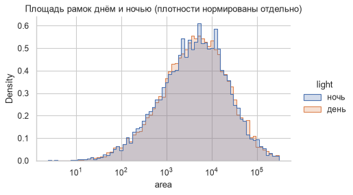
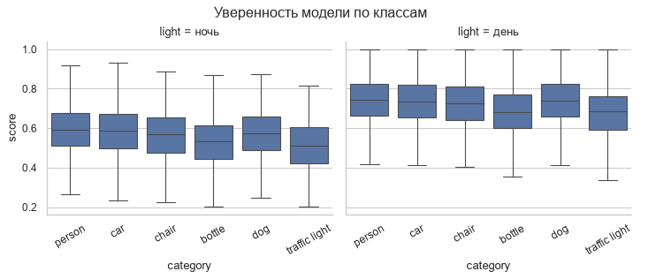
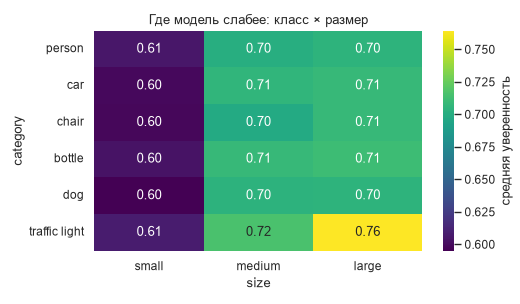
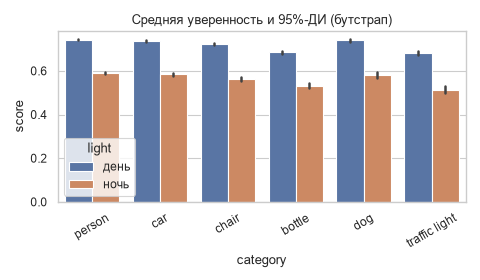
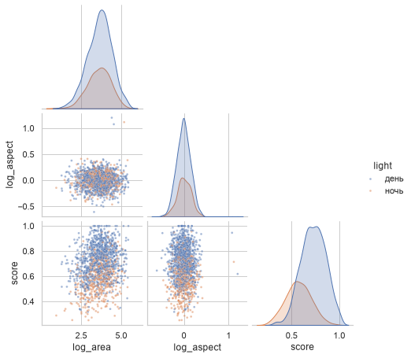
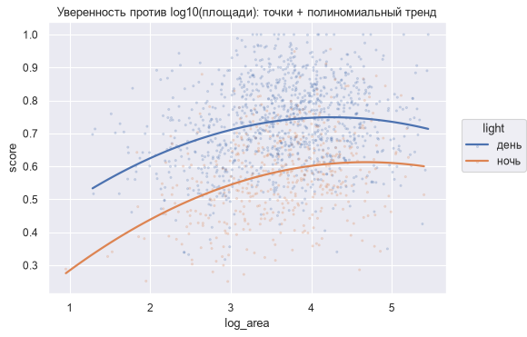

# Урок 24. Seaborn для EDA

**Модуль 2 · Основные библиотеки** · ≈ 1,5 ч · пререквизиты: уроки 17, 22
**Узел roadmap:** Seaborn
**Задания:** [Задания.md](Задания.md) · **Код:** [код/](код/) · **Решения:** [решения/](решения/)

---

## 1. Зачем это нужно

В уроке 17 каждый EDA-график мы собирали вручную на Matplotlib: группировка, цвета, легенды. Seaborn делает это одной строкой, **если данные в «длинном» формате**. Кроме того, он сам считает статистику (средние, доверительные интервалы, KDE, регрессию) и рисует её. Для разведки датасета и анализа ошибок модели это в разы быстрее. Но нужно понимать, **что именно** он посчитал, иначе легко неверно прочитать график.

## 2. Интуиция: длинный формат и семантика колонок

Seaborn ждёт **длинный (tidy) формат**: одна строка — одно наблюдение, одна колонка — одна переменная. Это ровно таблица аннотаций из урока 22: строка — рамка, колонки — класс, площадь, уверенность, день/ночь.

Ты не рисуешь «линию для каждой модели». Ты говоришь, какая колонка за что отвечает:
- `x=`, `y=` — оси;
- `hue=` — цвет;
- `col=`, `row=` — разбить на отдельные графики (small multiples);
- `size=`, `style=` — размер и стиль маркера.

Широкую таблицу (эпохи × модели) переводят в длинную через `melt` (тест [код/test_long_format.py](код/test_long_format.py)).

Два уровня функций:
- **axes-level** (`histplot`, `boxplot`, `heatmap`, `barplot`) рисуют в переданный `ax` и встраиваются в любую сетку Matplotlib;
- **figure-level** (`displot`, `catplot`, `relplot`, `pairplot`) создают свою фигуру и умеют `col`/`row`.

## 3. Как это устроено: какую статистику рисует seaborn

| Функция | Что считает | На что обратить внимание |
|---|---|---|
| `barplot`, `pointplot` | Среднее (`estimator`) и **95%-ДИ бутстрепом** (`errorbar=("ci", 95)`) | Это не std и не стандартная ошибка. Для разброса данных — `errorbar="sd"` |
| `histplot`, `displot` | Гистограмма; `stat=` count / density / probability | При `hue` по умолчанию `common_norm=True` — группы нормируются **вместе**, и маленькая группа выглядит «низкой» |
| `kdeplot` | KDE с шириной по правилу Скотта (урок 17), `bw_adjust` — множитель | Вытекает за границы ограниченных величин |
| `boxplot` | Медиана, квартили, усы 1,5·IQR (урок 16) | `showfliers=False` прячет выбросы — но они могут быть важны |
| `violinplot` | KDE в каждой группе | На маленьких группах — артефакты сглаживания |
| `regplot`, `lmplot` | Линейная (или полиномиальная) регрессия МНК (урок 5) + бутстреп-ДИ | Не путать с причинностью |
| `heatmap` | Ничего не считает, рисует матрицу | Сначала `pivot_table` |

В коде урока ДИ, который seaborn нарисовал на `barplot`, извлечён из графика и сверен с нашим бутстрапом из урока 18:

```
person/день: ДИ seaborn [0.7402, 0.7462] | свой бутстрап [0.7402, 0.7462]
```

Совпало до 4 знаков: seaborn делает ровно перцентильный бутстрап.

## 4. Реализация: шесть EDA-графиков

Файл: [код/eda_seaborn.py](код/eda_seaborn.py) — те же синтетические аннотации, что в уроках 16–17.

**1. Распределение с разбивкой по группам** — `displot` с `hue`, log-шкалой и раздельной нормировкой (`common_norm=False`):

```python
sns.displot(df, x="area", hue="light", log_scale=True, element="step", stat="density", common_norm=False)
```



**2. Small multiples** — `catplot(..., col="light")`: день и ночь на соседних графиках с общей осью Y.



**3. Тепловая карта сводной таблицы** — сначала `pivot_table` (урок 22), потом `heatmap(annot=True)`:



Мелкие объекты любого класса — самая слабая зона (≈ 0,60). Это прямое указание, куда смотреть при улучшении детектора.

**4. Средние с 95%-ДИ** (бутстрап, сверен выше):



**5. `pairplot`** — все попарные связи признаков на подвыборке, `corner=True` убирает дубли:



**6. Декларативный интерфейс `seaborn.objects`** — график как композиция слоёв и статистических преобразований (точки + полиномиальный тренд):

```python
(so.Plot(sub, x="log_area", y="score", color="light")
   .add(so.Dots(alpha=0.2, pointsize=2))
   .add(so.Line(linewidth=2), so.PolyFit(order=2)))
```



## 5. Сравнение с Matplotlib

Тот же график «уверенность по классам днём и ночью с ДИ» на чистом Matplotlib потребовал бы: `groupby` → бутстрап по группам (урок 18) → расчёт позиций столбцов → `ax.bar` дважды со смещением → `ax.errorbar` → легенда. Это около 20 строк против одной. Но понимать эти 20 строк нужно, иначе непонятно, что показывают «усы».

Seaborn построен поверх Matplotlib, поэтому всё настраивается через `ax` (подписи, лимиты, поворот меток). Axes-level функции принимают `ax=` и встраиваются в любые сетки из урока 23.

## 6. Типичные ошибки и как их отлаживать

| Ошибка | Последствие | Как правильно |
|---|---|---|
| Широкий формат данных | Приходится рисовать в цикле | `melt` в длинный формат |
| «Усы» `barplot` считаются разбросом данных | Неверный вывод: ДИ среднего в $\sqrt n$ раз уже разброса | Знать `errorbar=`: `("ci", 95)`, `"se"`, `"sd"`, `("pi", 50)` |
| `hue` с общей нормировкой | Малая группа выглядит «низкой» | `common_norm=False` или `stat="density"` |
| Порядок `hue` и категорий «как получится» | Цвета меняются от графика к графику, ручные сверки ломаются (в коде урока это и случилось до `hue_order`) | Явные `order=`, `hue_order=` |
| `pairplot` на всём датасете и всех колонках | Минуты рендера, нечитаемо | Подвыборка и 3–5 ключевых признаков |
| Подписи на тепловой карте наезжают | Нечитаемые оси | `ax.tick_params(rotation=0)`, размер фигуры |
| `sns.set_theme()` в библиотечном коде | Меняет стиль всем графикам проекта | Ставить тему в ноутбуке, а не в модуле |

## 7. Упражнения

Вынесены в отдельный файл: **[Задания.md](Задания.md)**.

## 8. Вопросы для самопроверки

1. Что такое длинный (tidy) формат и почему seaborn требует его?
2. Чем axes-level функции отличаются от figure-level? Когда что использовать?
3. Что показывают «усы» на `barplot` по умолчанию? Как показать стандартное отклонение?
4. Что делает `common_norm=False` в `histplot` и когда это важно?
5. Как построить тепловую карту «класс × размер» средней уверенности?
6. Почему важно фиксировать `order` и `hue_order`?

## 9. Ресурсы

### Узел «Seaborn»

| | Ресурс | Язык · цена · уровень | Зачем открыть |
|---|---|---|---|
| ⭐ 📄 | seaborn, [User guide and tutorial](https://seaborn.pydata.org/tutorial.html) — проверить ссылку | EN · бесплатно · базовый | Официальный учебник: data structures, distributions, categorical, error bars |
| 📄 | seaborn, [Statistical estimation and error bars](https://seaborn.pydata.org/tutorial/error_bars.html) — проверить ссылку | EN · бесплатно · базовый | Что именно рисуют «усы» — ровно раздел 3 |
| 🧪 | Kaggle Learn, [Data Visualization](https://www.kaggle.com/learn/data-visualization) — проверить ссылку | EN · бесплатно · базовый | Практика seaborn с автопроверкой |
| 🎥 | mlcourse.ai, [тема 2 — визуальный анализ данных](https://github.com/Yorko/mlcourse.ai) | RU/EN · бесплатно · базовый | EDA с seaborn от ODS |
| 📄 | [seaborn.pydata.org](https://seaborn.pydata.org/) и видео [Seaborn Tutorial](https://www.youtube.com/watch?v=6GUZXDef2U0) [roadmap.sh] | EN · бесплатно · базовый | Ресурсы, прикреплённые к узлу на roadmap.sh |

---

## Ответы на вопросы для самопроверки

1. Одна строка — одно наблюдение, одна колонка — одна переменная. Тогда группировки задаются именами колонок (`hue`, `col`), и seaborn сам делает split–apply–combine.
2. Axes-level рисуют в один `ax` и встраиваются в любые сетки. Figure-level создают свою фигуру (`FacetGrid`) и поддерживают `col`/`row` для small multiples.
3. 95%-доверительный интервал среднего, построенный бутстрепом. Разброс данных — `errorbar="sd"`.
4. Каждая группа нормируется отдельно, и формы распределений сравнимы даже при разном размере групп. Важно при дисбалансе (ночных кадров 30%, дневных 70%).
5. `pivot = df.pivot_table(index="category", columns="size", values="score", aggfunc="mean", observed=True)`, затем `sns.heatmap(pivot, annot=True, fmt=".2f")`.
6. Иначе порядок определяется появлением значений в данных и может отличаться между графиками и запусками: цвета «перепрыгивают», а ручные сверки (как в коде урока) сравнивают не те столбцы.

---

**Дальше — Квиз 6** (уроки 22–24): [../Квиз 06. Уроки 22–24/Квиз.md](../Квиз%2006.%20Уроки%2022–24/Квиз.md), затем **мини-проект 2: EDA аннотаций COCO**.
