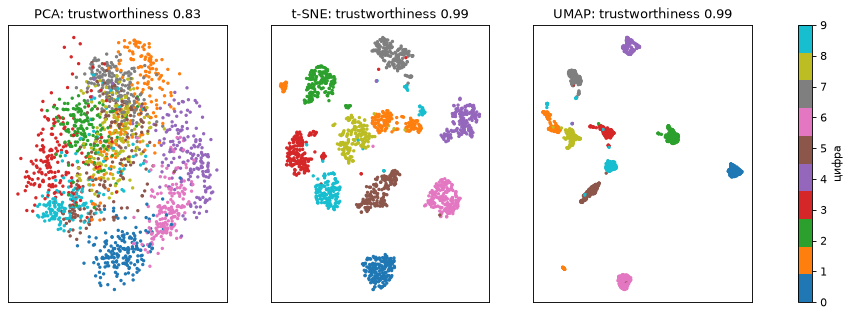

# Урок 30. Снижение размерности: PCA как инструмент, случайные проекции, t-SNE и UMAP

**Модуль 4 · Очистка данных** · ≈ 2 ч · пререквизиты: урок 7
**Узел roadmap:** Dimensionality Reduction · **[доп.]** t-SNE и UMAP для визуализации эмбеддингов
**Задания:** [Задания.md](Задания.md) · **Код:** [код/](код/) · **Решения:** [решения/](решения/)

> Здесь PCA — **инструмент** предобработки и визуализации. Полный вывод и PCA как модель обучения без учителя — урок 48, а математика уже есть в уроке 7 (SVD, Эккарт–Юнг).

---

## 1. Зачем это нужно

- **Визуализация эмбеддингов.** У тебя 50 000 эмбеддингов кропов из детектора (512 чисел каждый). Как увидеть, на какие кластеры они делятся, где перепутаны классы, где выбросы? Нужно перейти в 2D. FiftyOne Brain и TensorBoard Projector делают это через PCA, t-SNE и UMAP.
- **Ускорение и сжатие.** KNN, кластеризация и поиск похожих по 512-мерным векторам медленные. PCA до 64 измерений или случайная проекция ускоряют их в разы почти без потери качества.
- **Борьба с проклятием размерности.** В высоких размерностях «ближайший» сосед почти так же далёк, как самый далёкий, и методы на расстояниях теряют смысл.

## 2. Интуиция

- **Проклятие размерности.** В 1000-мерном кубе почти весь объём — у поверхности, а расстояния между случайными точками почти одинаковы. В коде урока отношение «(самое далёкое − самое близкое) / самое близкое» падает с 66 в 2D до 0,11 в 1000D.
- **PCA** находит оси наибольшего разброса и проецирует данные на первые $k$ из них. Это **линейный** метод, он сохраняет **глобальную** структуру: большие расстояния и общую форму облака.
- **Случайная проекция** умножает данные на случайную матрицу. Как ни странно, попарные расстояния при этом почти сохраняются, если целевая размерность не слишком мала. Обучать ничего не нужно.
- **t-SNE и UMAP** — **нелинейные** методы для **визуализации**. Они стараются сохранить, кто чей **сосед**, и ради этого искажают глобальные расстояния. Поэтому на картинке t-SNE расстояния между кластерами и размеры кластеров почти ничего не значат.

## 3. Математика

### 3.1. Концентрация расстояний

Для точек с $d$ независимыми координатами квадрат расстояния — сумма $d$ независимых слагаемых. Его среднее растёт как $d$, а стандартное отклонение — как $\sqrt d$ (урок 14). Относительный разброс расстояний $\sim\sqrt d / d = 1/\sqrt d \to 0$: все расстояния становятся почти одинаковыми. Для KNN это значит, что «ближайший» перестаёт быть заметно ближе остальных. Реальные данные спасает то, что они лежат на многообразии низкой размерности внутри большого пространства. PCA и UMAP пытаются его найти.

### 3.2. PCA: выбор числа компонент

Напоминание (уроки 6–7): главные компоненты — собственные векторы ковариации, дисперсии — собственные значения $\lambda_i$. Доля объяснённой дисперсии первых $k$ — $\sum_{i\le k}\lambda_i / \sum_i\lambda_i$. Средняя ошибка реконструкции равна сумме отброшенных $\lambda_i$ (Эккарт–Юнг; тест `test_pca_error_equals_dropped_variance`). Практические способы выбрать $k$:
- порог доли дисперсии (90–95%);
- «локоть» на графике $\lambda_i$;
- **лучше всего** — по качеству итоговой задачи на кросс-валидации, внутри `Pipeline`.

### 3.3. Лемма Джонсона–Линденштраусса

Для любых $n$ точек и $0 < \varepsilon < 1$ существует линейное отображение в $\mathbb{R}^k$ с

$$k \ge \frac{4\ln n}{\varepsilon^2/2 - \varepsilon^3/3},$$

при котором **все** попарные расстояния сохраняются с точностью $(1 \pm \varepsilon)$. Случайная гауссова матрица $R \in \mathbb{R}^{k \times d}$ с элементами $\mathcal{N}(0, 1/k)$ подходит с высокой вероятностью.

Почему: для фиксированного вектора $x$ каждая координата $Rx$ — нормальная величина с дисперсией $\|x\|^2/k$. Значит, $\|Rx\|^2$ — среднее $k$ таких квадратов, и оно концентрируется вокруг $\|x\|^2$ с относительным разбросом $\sim 1/\sqrt k$. Объединение по всем $\binom n2$ парам добавляет множитель $\ln n$. Поразительно: $k$ **не зависит от исходной размерности** $d$.

### 3.4. t-SNE и UMAP (идея)

**t-SNE:** в исходном пространстве для каждой точки — вероятности «быть соседом» $p_{j|i} \propto \exp(-\|x_i - x_j\|^2/2\sigma_i^2)$. Ширина $\sigma_i$ подбирается так, чтобы «эффективное число соседей» равнялось **perplexity**. В 2D — вероятности с тяжёлыми хвостами Стьюдента: $q_{ij} \propto (1 + \|y_i - y_j\|^2)^{-1}$. Положения $y$ ищутся градиентным спуском по $\text{KL}(P\|Q)$ (урок 15). Несимметричность KL сильно штрафует, если близкие соседи разъехались, и слабо — если далёкие сблизились. Поэтому t-SNE сохраняет локальную структуру и жертвует глобальной. Тяжёлые хвосты позволяют разнести кластеры, но расстояния между ними **не интерпретируются**.

**UMAP:** похожая идея (граф соседей → его вложение в 2D), но с другой функцией потерь и инициализацией. Обычно быстрее t-SNE, чуть лучше сохраняет глобальную структуру и умеет `transform` для новых точек.

**Чего у t-SNE нет:** преобразования для новых данных. Это метод визуализации, а не признаки для модели.

## 4. Реализация

Файл: [код/reduce.py](код/reduce.py):

```
отношение (самое далёкое − самое близкое) / самое близкое для 500 случайных точек в кубе:
  d =    2: 66.13
  d =   10: 2.32
  d =  100: 0.36
  d = 1000: 0.11
PCA: для 90% дисперсии нужно 21 компонент из 64
PCA: для 95% дисперсии нужно 29 компонент из 64
  k =  5: ошибка реконструкции   8.54, KNN accuracy 0.884
  k = 10: ошибка реконструкции   4.91, KNN accuracy 0.940
  k = 20: ошибка реконструкции   1.98, KNN accuracy 0.961
  k = 40: ошибка реконструкции   0.22, KNN accuracy 0.966
  все 64: KNN accuracy 0.967

Джонсон–Линденштраусс: для n=1000, ε=0.2 нужно k ≥ 1594
  k =   50: отношение расстояний после/до в [0.663, 1.346]
  k =  500: отношение расстояний после/до в [0.891, 1.105]
  k = 1500: отношение расстояний после/до в [0.937, 1.061]

2D-вложение | trustworthiness (сохранение соседей) | KNN accuracy в 2D
  PCA    0.830  0.603
  t-SNE  0.993  0.976
  UMAP   0.989  0.981
```

- **PCA:** 20 компонент из 64 дают почти то же качество KNN (96,1% против 96,7%) при втрое меньшей размерности.
- **Случайная проекция** 10 000 → 1500 сохранила все 3000 проверенных расстояний в пределах ±6%. Это лучше гарантии $\varepsilon = 0{,}2$: лемма — оценка для **худшего** случая всех пар.
- **Trustworthiness** (насколько соседи в 2D были соседями и в исходном пространстве): t-SNE и UMAP ≈ 0,99, PCA — 0,83. На цифрах классы — разные «многообразия», и линейная проекция на 2 оси их сминает.
- **Осторожно с последней колонкой.** «KNN accuracy в 2D» для t-SNE и UMAP посчитана на вложении, построенном по **всем** точкам, включая тестовые фолды. Метки при этом не использовались, но тестовые точки влияли на положение обучающих. Для t-SNE применить вложение к новым данным вообще нельзя. Это иллюстрация того, насколько хорошо разделены классы, а не оценка классификатора.



## 5. Библиотеки

- `sklearn.decomposition.PCA` (`n_components` числом или долей дисперсии, например `0.95`; `whiten=True`), `TruncatedSVD` для разреженных данных (урок 7), `IncrementalPCA` для данных, не влезающих в память.
- `sklearn.random_projection.GaussianRandomProjection` / `SparseRandomProjection`, `johnson_lindenstrauss_min_dim`.
- `sklearn.manifold.TSNE` (`perplexity` 5–50, `init="pca"` для стабильности), `trustworthiness`.
- `umap-learn` (`umap.UMAP`: `n_neighbors` — локальность против глобальности, `min_dist` — плотность кластеров).

## 6. Типичные ошибки и как их отлаживать

| Ошибка | Последствие | Как правильно |
|---|---|---|
| PCA без масштабирования признаков разной природы | Первые компоненты — просто признаки с наибольшими единицами | `StandardScaler` перед PCA (урок 29); для пикселей — не нужно |
| PCA, обученный на всех данных до сплита | Утечка (урок 27) | PCA внутри `Pipeline` |
| t-SNE как признаки для модели | Нет `transform` для новых данных; вложение зависит от теста | t-SNE/UMAP — только для визуализации; для признаков — PCA или UMAP с `transform` и осторожностью |
| Интерпретация расстояний между кластерами и их размеров на t-SNE | Ложные выводы («класс A ближе к B, чем к C») | Смотреть только «кто с кем соседствует»; проверять на нескольких perplexity и сидах |
| Один запуск t-SNE | Картинка зависит от сида и perplexity | Несколько запусков; фиксированный `random_state` в отчётах |
| KNN в 1000D без снижения размерности | Расстояния почти равны, качество падает | PCA / случайная проекция; косинус на нормированных эмбеддингах (урок 3) |

## 7. Упражнения

Вынесены в отдельный файл: **[Задания.md](Задания.md)**.

## 8. Вопросы для самопроверки

1. Что такое проклятие размерности? Почему относительный разброс расстояний убывает как $1/\sqrt d$?
2. Как выбрать число компонент PCA? Какой способ самый честный?
3. Сформулируй лемму Джонсона–Линденштраусса. Почему $k$ не зависит от исходной размерности?
4. Чем t-SNE отличается от PCA по тому, что он сохраняет? Что нельзя интерпретировать на t-SNE-картинке?
5. Почему t-SNE нельзя использовать как шаг предобработки перед классификатором?
6. Что измеряет trustworthiness?

## 9. Ресурсы

### Узел «Dimensionality Reduction»

| | Ресурс | Язык · цена · уровень | Зачем открыть |
|---|---|---|---|
| ⭐ 📄 | Wattenberg, Viégas, Johnson, [How to Use t-SNE Effectively](https://distill.pub/2016/misread-tsne/) (Distill, 2016) — проверить ссылку | EN · бесплатно · базовый | Интерактивно: как perplexity, сид и число шагов меняют картинку и что на ней нельзя читать |
| 📄 | scikit-learn, [Decomposing signals (PCA)](https://scikit-learn.org/stable/modules/decomposition.html#pca), [Manifold learning](https://scikit-learn.org/stable/modules/manifold.html), [Random Projection](https://scikit-learn.org/stable/modules/random_projection.html) — проверить ссылки | EN · бесплатно · базовый | Все методы урока и параметры |
| 📑 | van der Maaten, Hinton, *Visualizing Data using t-SNE* (JMLR, 2008) — найти по названию | EN · бесплатно · продвинутый | Оригинал t-SNE |
| 📑 | McInnes, Healy, Melville, *UMAP: Uniform Manifold Approximation and Projection for Dimension Reduction* (arXiv:1802.03426) — найти по названию | EN · бесплатно · продвинутый | Оригинал UMAP |
| 📄 | UMAP, [How UMAP Works](https://umap-learn.readthedocs.io/en/latest/how_umap_works.html) — проверить ссылку | EN · бесплатно · продвинутый | Объяснение UMAP от автора без тяжёлой топологии |
| 📄 | IBM, [Dimensionality reduction](https://www.ibm.com/think/topics/dimensionality-reduction) и [видео](https://www.youtube.com/watch?v=AU_hBML2H1c) [roadmap.sh] | EN · бесплатно · базовый | Ресурсы, прикреплённые к узлу на roadmap.sh |

---

## Ответы на вопросы для самопроверки

1. В высокой размерности расстояния между случайными точками почти одинаковы, и методы на расстояниях теряют смысл. Квадрат расстояния — сумма $d$ независимых слагаемых: среднее $\propto d$, std $\propto\sqrt d$, относительный разброс $\propto 1/\sqrt d$.
2. По доле объяснённой дисперсии (90–95%), по «локтю» спектра или — честнее всего — по качеству итоговой задачи на кросс-валидации с PCA внутри Pipeline.
3. $n$ точек можно линейно отобразить в $k = O(\log n/\varepsilon^2)$ измерений с сохранением всех попарных расстояний до множителя $1 \pm \varepsilon$. Для одной пары $\|Rx\|^2$ — среднее $k$ независимых квадратов, его разброс зависит от $k$, а не от $d$. Число пар даёт $\log n$.
4. PCA — линейная проекция, сохраняет глобальную структуру и большие расстояния. t-SNE сохраняет соседство (локальную структуру) ценой искажения глобальной. Нельзя интерпретировать расстояния между кластерами, их размеры и плотности.
5. У t-SNE нет `transform` для новых точек. Вложение строится по всем данным сразу (включая тест), и оно сильно зависит от параметров и сида.
6. Насколько $k$ ближайших соседей точки в низкоразмерном вложении были её соседями и в исходном пространстве. Штрафуются «ложные соседи», появившиеся при проекции.

---

**Дальше — Квиз 8** (уроки 27–30): [../Квиз 08. Уроки 27–30/Квиз.md](../Квиз%2008.%20Уроки%2027–30/Квиз.md). После него — **урок 31: отбор признаков**.
