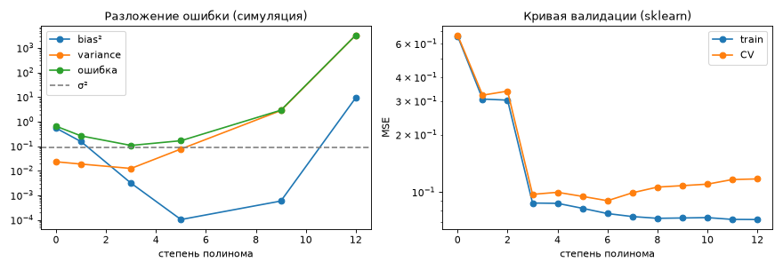

# Урок 32. Что такое машинное обучение: обобщение и компромисс смещения и разброса

**Модуль 5 · Машинное обучение: введение** · ≈ 2 ч · пререквизиты: уроки 15, 18
**Узел roadmap:** What is Machine Learning? · **[доп.]** разложение ошибки на смещение и разброс (bias–variance)
**Задания:** [Задания.md](Задания.md) · **Код:** [код/](код/) · **Решения:** [решения/](решения/)

---

## 1. Зачем это нужно

Ты дообучаешь YOLO: train-потеря падает, а mAP на валидации сначала растёт, потом стоит, потом падает. Ты добавляешь аугментации — валидация растёт. Берёшь модель побольше — становится хуже. Берёшь вдвое больше данных — лучше. Все эти наблюдения объясняет одна идея: **ошибка на новых данных складывается из смещения, разброса и шума**, и каждое решение (размер модели, регуляризация, данные, аугментации) двигает баланс между ними. Это главный инструмент «отладки» обучения, к которому курс будет возвращаться постоянно.

## 2. Интуиция

**Машинное обучение** — построение функции по примерам вместо написания её руками (Software 2.0, урок 1). Цель — не хорошо описать обучающие данные (это просто запоминание), а хорошо предсказывать **новые** данные из того же распределения. Это **обобщение (generalization)**.

Представь, что ты обучаешь одну и ту же модель много раз на разных случайных выборках из одного источника данных:
- **Смещение (bias)** — насколько «средняя» из этих моделей промахивается мимо истины. Прямая, которой аппроксимируют синусоиду, промахивается при любой выборке: модель **слишком проста** (недообучение, underfitting).
- **Разброс (variance)** — насколько модели, обученные на разных выборках, отличаются друг от друга. Полином 9-й степени по 30 точкам проходит через шум, и на каждой выборке получается своя «змея»: модель **слишком гибкая** (переобучение, overfitting).
- **Шум** — то, что не предсказать никакой моделью: ошибки разметки, случайность.

Аналогия — стрельба по мишени. Bias — систематический сдвиг прицела. Variance — разброс попаданий вокруг точки, куда стрелок целится.

## 3. Математика

### 3.1. Постановка (напоминание из урока 1)

Данные $(x, y) \sim P$, $y = f(x) + \varepsilon$, $\mathbb{E}\varepsilon = 0$, $\operatorname{Var}\varepsilon = \sigma^2$. По обучающей выборке $D$ строим $\hat f_D$ минимизацией эмпирического риска. **Ошибка обобщения** — ожидаемая потеря на новой точке. **Разрыв обобщения (generalization gap)** — разность ошибок на новых и на обучающих данных.

### 3.2. Вывод разложения для квадратичной потери

Зафиксируем точку $x$. Ожидание берём по случайной обучающей выборке $D$ и по шуму $\varepsilon$ новой точки (они независимы). Обозначим $\bar f(x) = \mathbb{E}_D[\hat f_D(x)]$ — «средняя модель».

$$\mathbb{E}\big[(y - \hat f_D)^2\big] = \mathbb{E}\big[(f + \varepsilon - \hat f_D)^2\big] = \mathbb{E}[\varepsilon^2] + \mathbb{E}\big[(f - \hat f_D)^2\big] + 2\,\mathbb{E}[\varepsilon]\,\mathbb{E}[f - \hat f_D].$$

Последнее слагаемое — ноль ($\mathbb{E}\varepsilon = 0$, независимость). Во втором прибавим и вычтем $\bar f$:

$$\mathbb{E}\big[(f - \bar f + \bar f - \hat f_D)^2\big] = (f - \bar f)^2 + \mathbb{E}\big[(\bar f - \hat f_D)^2\big] + 2(f - \bar f)\,\underbrace{\mathbb{E}[\bar f - \hat f_D]}_{=0}.$$

Итого:

$$\boxed{\mathbb{E}\big[(y - \hat f_D(x))^2\big] = \underbrace{\sigma^2}_{\text{шум}} + \underbrace{\big(f(x) - \bar f(x)\big)^2}_{\text{bias}^2} + \underbrace{\operatorname{Var}_D\big[\hat f_D(x)\big]}_{\text{variance}}.}$$

Это та же техника «прибавить и вычесть среднее», что в выводе $\operatorname{Var} = \mathbb{E}X^2 - (\mathbb{E}X)^2$ (урок 14).

### 3.3. Что двигает баланс

| Действие | Bias | Variance |
|---|---|---|
| Сложнее модель (больше степень, глубже дерево, меньше $k$ в KNN) | ↓ | ↑ |
| Сильнее регуляризация (урок 13: prior на веса) | ↑ | ↓ |
| Больше обучающих данных | ≈ | ↓ (усреднение, урок 14) |
| Аугментации | ≈ | ↓ (по сути, больше данных) |
| Ансамбль (бэггинг, урок 42) | ≈ | ↓ |
| Лучшие признаки (урок 28) | ↓ | ≈ |

**Шум $\sigma^2$ не уменьшить моделью** — только данными лучшего качества. Если в тесте 5% ошибочных меток, accuracy выше ≈ 95% там недостижима для **правильной** модели (урок 27).

### 3.4. Оговорка про глубокое обучение

Классическая U-образная кривая «ошибка от сложности» в больших нейросетях нарушается. После точки, где модель может идеально запомнить обучающие данные, ошибка на тесте может снова падать — это **двойной спуск (double descent)**. Причина — неявная регуляризация градиентного спуска и архитектуры. Но сам язык bias/variance и практические рычаги из таблицы остаются рабочими.

## 4. Реализация: разложение симуляцией

Файл: [код/bias_variance.py](код/bias_variance.py). Истинная функция — $\sin 2\pi x$, шум $\sigma = 0{,}3$, 30 обучающих точек. 500 раз генерируем новую выборку, обучаем модель и смотрим её предсказания в 50 точках:

```python
def decompose(fit_predict, n_train=30, n_sets=500):
    preds = np.empty((n_sets, x_test.size))
    for s in range(n_sets):
        x = rng.uniform(0, 1, n_train)
        y = f(x) + rng.normal(0, SIGMA, n_train)
        preds[s] = fit_predict(x, y, x_test)
    mean_pred = preds.mean(axis=0)
    bias2 = np.mean((mean_pred - f(x_test)) ** 2)
    variance = np.mean(preds.var(axis=0))
    y_new = f(x_test) + rng.normal(0, SIGMA, (n_sets, x_test.size))
    total = np.mean((y_new - preds) ** 2)
    return bias2, variance, total
```

```
неустранимый шум σ² = 0.090
степень | bias²  | variance | σ²+bias²+var | средняя ошибка (симуляция)
      0 | 0.543  |    0.023 |        0.656 | 0.650
      1 | 0.154  |    0.019 |        0.263 | 0.262
      3 | 0.003  |    0.012 |        0.106 | 0.107
      5 | 0.000  |    0.077 |        0.167 | 0.167
      9 | 0.001  |    2.821 |        2.912 | 2.909
     12 | 9.405  | 3286.355 |     3295.850 | 3295.848

KNN k  | bias²  | variance
     1 | 0.000  | 0.097
     3 | 0.001  | 0.040
    10 | 0.028  | 0.025
    25 | 0.416  | 0.028

validation_curve: лучшая степень по CV = 6
```

- Сумма $\sigma^2 + \text{bias}^2 + \text{variance}$ совпала с ошибкой, измеренной напрямую. Разложение подтверждено (и тестом).
- **Степень 0–1:** ошибка почти вся из смещения. **Степень 3:** минимум ошибки, 0,107 — почти на уровне шума 0,09. **Степень 9–12:** разброс взрывается. При степени 12 на 30 точках сама подгонка численно неустойчива: матрица полиномиальных признаков ужасно обусловлена (урок 5). Предсказания на краях отрезка уходят в тысячи, и даже «средняя» модель промахивается — отсюда большое bias².
- **KNN:** $k = 1$ — нулевое смещение и разброс, равный шуму (предсказание — одна шумная точка). С ростом $k$ разброс падает, смещение растёт.
- **Кривая валидации sklearn** на одной выборке из 60 точек выбрала степень 6. Это оценка по одной выборке, а не по распределению: она шумная и при 60 точках допускает более сложную модель, чем 3 при 30 точках.



## 5. Сверка с библиотекой: диагностика по кривым

В реальности истинной $f$ нет, и bias/variance напрямую не посчитать. Их диагностируют по кривым:
- **кривая валидации** (`validation_curve`): ошибка train и CV от гиперпараметра сложности. Обе высокие и близкие — смещение. Train низкая, CV высокая — разброс;
- **кривая обучения** (`learning_curve`): ошибки от размера обучающей выборки. Если CV-ошибка ещё падает с ростом данных — данные помогут (высокий разброс). Если кривые сошлись на высоком уровне — нужна более сложная модель или лучшие признаки.

## 6. Типичные ошибки и как их отлаживать

| Симптом | Диагноз | Что делать |
|---|---|---|
| Train и val ошибки высокие и близкие | Высокое смещение (недообучение) | Сложнее модель, лучше признаки, меньше регуляризации, дольше учить |
| Train низкая, val высокая | Высокий разброс (переобучение) | Больше данных, аугментации, регуляризация, проще модель, ранняя остановка |
| Val ошибка не падает ниже уровня | Возможно, шум разметки | Проверить разметку (урок 27); оценить согласие разметчиков |
| «Модель лучше на тесте, чем на train» | Утечка, или регуляризация/dropout только на train, или тест проще | Проверить сплит и режимы train/eval |
| Выбор сложности по тесту | Оптимистичная оценка (урок 18) | Выбирать по валидации или CV, тест — один раз |

## 7. Упражнения

Вынесены в отдельный файл: **[Задания.md](Задания.md)**.

## 8. Вопросы для самопроверки

1. Что такое обобщение и разрыв обобщения?
2. Выведи разложение ожидаемой квадратичной ошибки на шум, смещение² и разброс.
3. Как сложность модели, регуляризация, объём данных и аугментации влияют на смещение и разброс?
4. Почему KNN с $k = 1$ имеет почти нулевое смещение и разброс, равный шуму?
5. Как по кривым обучения отличить проблему смещения от проблемы разброса?
6. Почему ошибку ниже уровня шума разметки нельзя получить честно?
7. Что такое двойной спуск и почему он не отменяет практические выводы урока?

## 9. Ресурсы

### Узел «What is Machine Learning?»

| | Ресурс | Язык · цена · уровень | Зачем открыть |
|---|---|---|---|
| ⭐ 📘 | James et al., [ISLP](https://www.statlearning.com/), **гл. 2 «Statistical Learning»** (2.2.2 — The Bias-Variance Trade-Off) | EN · бесплатно · базовый | Лучшее вводное изложение обобщения и bias–variance с картинками |
| 📘 | Яндекс, [Учебник по ML](https://contest.yandex.ru/tracks/ml) — вводная глава и раздел о bias–variance | RU · бесплатно · базовый | На русском |
| 🎥 | К. В. Воронцов, «Машинное обучение» (лекции ШАД), вводная лекция — найти по названию | RU · бесплатно · продвинутый | Строгая постановка задачи обучения на русском |
| 📑 | Belkin et al., *Reconciling modern machine learning practice and the bias-variance trade-off* (PNAS, 2019), arXiv:1812.11118 — найти по названию | EN · бесплатно · продвинутый | Двойной спуск: оригинальная статья |
| 📘 | Alexander Jung, [Machine Learning: The Basics](https://github.com/alexjungaalto/MachineLearningTheBasics/blob/master/MLBasicsBook.pdf) [roadmap.sh] | EN · бесплатно · базовый | Книга, прикреплённая к узлу на roadmap.sh: данные, модель, потеря — три компонента ML |
| 📄 | IBM, [What is machine learning?](https://www.ibm.com/topics/machine-learning) и видео ([1](https://www.youtube.com/watch?v=9gGnTQTYNaE), [2](https://www.youtube.com/watch?v=PtYRUoJRE9s)) [roadmap.sh] | EN · бесплатно · базовый | Обзорные ресурсы узла на roadmap.sh |

---

## Ответы на вопросы для самопроверки

1. Обобщение — качество на новых данных из того же распределения. Разрыв — разность ошибки на новых и на обучающих данных.
2. См. 3.2: $y - \hat f = \varepsilon + (f - \bar f) + (\bar f - \hat f)$; перекрёстные члены зануляются, так как $\mathbb{E}\varepsilon = 0$ и $\mathbb{E}_D[\bar f - \hat f_D] = 0$. Остаются $\sigma^2 + (f - \bar f)^2 + \operatorname{Var}\hat f$.
3. Сложность: bias ↓, variance ↑. Регуляризация: bias ↑, variance ↓. Данные и аугментации: variance ↓, bias почти не меняется.
4. Предсказание — значение ближайшей обучающей точки, $f(x_{nn}) + \varepsilon$. При плотных данных $f(x_{nn}) \approx f(x)$ (смещение ≈ 0), а разброс по выборкам — это дисперсия шума одной точки, $\sigma^2$.
5. Смещение: train- и val-ошибки сошлись на высоком уровне, больше данных не помогает. Разброс: большой зазор между train и val, val-ошибка падает с ростом данных.
6. Метрика сравнивает предсказание с шумной меткой. Даже идеальная модель $f$ ошибается на доле, равной доле шума. Меньшая ошибка значит, что модель подогналась под шум теста, то есть утечка или подбор по тесту.
7. Ошибка на тесте снова падает при сильной перепараметризации, за порогом интерполяции. Рычаги (данные, регуляризация, аугментации, ансамбли) работают так же, а для «классических» моделей и малых данных U-кривая остаётся.

---

**Следующий урок — урок 33: типы машинного обучения.** Команда: «Дальше».
